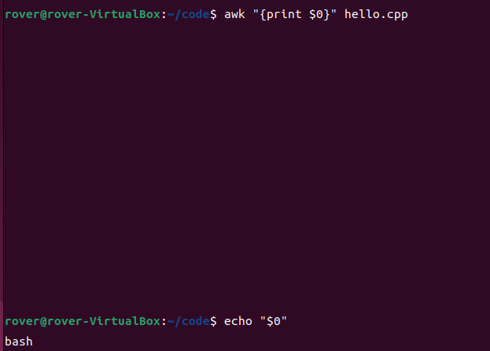

#### date：打印当前的日期和时间  

#### echo：将收到的参数打印出来  

#### cd：change directory 切换目录  

#### pwd：print working directory 打印当前工作目录 

#### which：可以查看命令的路径      

#### cat：打印文件内容 

#### sort：对文件中的内容每行按照字典序排序后输出  

#### uniq：删除重复的行   

#### head -n file：打印文件的前n行，默认打印前10行
- 参数 `-n` 表示打印文件的前n行
- head hello.cpp 就是默认打印 hello.cpp 文件的前10行
- head -3 hello.cpp 就是打印 hello.cpp 文件的前3行，

#### tail -n file：打印文件的后n行，默认打印后10行    
- tail hello.cpp
- tail -3 hello.cpp

#### grep：grep pattern file 打印文件中包含pattern的行  
- 打印文件中包含pattern的行，比如 grep "hello" hello.cpp  

#### sed -i "s/old/new/" file：在文件中替换所有包含old的行，将old替换为new  
- 参数 `-i` 表示直接在文件中替换，而不是打印到标准输出中  
- 引号中的 `s` 是 substitute 的缩写，替换的意思  
- 引号中的 `g` 是 global 的缩写，表示 **全局替换**，如果不加上 `g`，只会将一行中第一个匹配的 old 替换为 new  
- 不加上 `g` 是这么写的：sed -i "s/old/new/" file  

#### g++ file -o ouput_name：编译文件 file，将输出的可执行文件命名为 ouput_name  
- g++：这是 GNU C++ 编译器，它的作用就是将人类能看懂的 C++ 代码文本翻译为机器能看懂的二进制代码
- -o：代表 output ，它是用来告诉编译器："翻译完之后，请将生成的文件命名为后面的名字"，如果不加上 `-o` ，默认生成一个叫 `a.out` 的文件  

#### ./ouput_name：运行可执行文件 ouput_name  
- 前面有一个 . 是因为：
  - `.` 表示当前目录
  - 由于安全原因，Linux 系统默认不会在当前目录下寻找要执行的文件。如果直接输入 hello 回车的时候，系统只会去 `$PATH` 环境变量里定义的那些系统文件夹（比如 `/bin` `/usr/bin` 等）里找，找不到就报错：`command not found` 。
    
#### find：查找文件。find 【目录】 【选项】 【操作】
- find . -name "*.cpp"：查找当前目录下所有的 C++ 文件 
    - `*` 是通配符，表示任意多个字符
- find . -type f -name "*.cpp"：查找当前目录下所有的 C++ 文件
    - `-type f` 表示只查找文件，不查找目录
    - find . -type d -name "*.cpp"：查找当前目录下所有的 C++ 目录
        - `-type d` 表示只查找目录，不查找文件  

#### awk "条件 {动作}" file：在文件中查找满足条件的行，执行动作    

在 `awk` 中，**每行默认使用空格切分**，`$0` 表示当前行的所有内容， `$1` 表示当前行的第一个字段， `$2` 表示当前行的第二个字段，以此类推。  

  
## 🔍问题：这里写入命令 awk "{print $0}" hello.cpp，意思是打印 hello.cpp 文件的所有行，但是打印出来的是空的，为什么？  
因为在 Linux 系统的 Shell 中，单引号 `''` 和双引号 `""` 对特殊符号的处理是不同的
- 单引号 `''`：绝对原样传递。Shell 看到单引号，就里面的内容（包括 `$0`）原封不动地交给 `awk` 
- 双引号 `""`：允许变量替换。Shell 看到双引号中的 `$`，会试图去解析他。
**关键在于 `$0` 在 Shell 中本身就是一个内置变量** 

在 `Shell` 中，`$0` 代表当前正在运行的程序名称（通常就是 `-bahs` 或 `bash`）  

所以当输入 `awk "{print $0}" hello.cpp` 时，`Shell` 会将命令替换为 `awk "{print -bash}" hello.cpp`  

`awk` 拿到命令后，看到 `-bash` 这个它根本不认识的变量名，在 `awk` 里未定义的变量默认是空的，所以它就打印了一堆空行，导致你什么都看不见。  

#### 所以强烈建议使用单引号：
- 用`awk` 时
- 用`grep` 时
